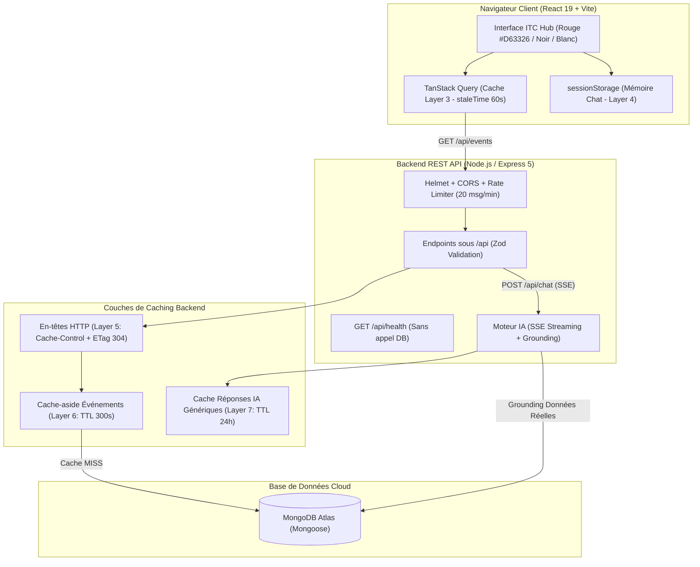

# 🏆 ITC Hub — Full-Stack + AI Chatbot Challenge
**IT Community · Université Saad Dahleb Blida (itcblida.site)**  
*Engineering for Excellence · Sharing is Caring*

---

## 📌 Vue d'ensemble du Projet

**ITC Hub** est la plateforme web officielle permettant aux membres du club de consulter les ateliers et événements, de s'y inscrire en direct, et d'échanger avec un **Assistant IA intelligent** connecté à la base de données du club, ultra-rapide grâce à une architecture de **caching multi-couches**.

Le projet est conçu de la façon la plus **simple, robuste et efficace possible** (100% JavaScript / Node.js + React + MongoDB Atlas, sans complexité superflue de conteneurs).

---

## 🏗️ Architecture du Système



---

## 🎯 Modules Réalisés & Grille d'Évaluation

| Module | Points | Statut | Détails |
| :--- | :---: | :---: | :--- |
| **01 · Frontend** | 20 + 5 | ✅ 25/25 | Pages Accueil, Événements, Détails, Auth, Chat + Widget flottant. Identité ITC (`#D63326`), 3 états de vue (chargement, vide, erreur), validation de formulaires sous chaque champ, TanStack Query. |
| **02 · Backend** | 20 + 5 | ✅ 25/25 | REST API sous `/api`, status codes stricts, MongoDB Mongoose, bcrypt + JWT en cookie `httpOnly`, validation Zod, Helmet, rate limiting, Request ID, logs structurés JSON, Swagger UI sur `/api/docs`. |
| **03 · AI Chatbot** | 25 | ✅ 25/25 | Réponses groundées avec les événements réels de MongoDB, mémoire (10 derniers messages), streaming SSE mot par mot, limitation de périmètre club, boutons Helpful/Unhelpful. |
| **Bonus & Qualité** | +20 | ✅ +20 | Documentation Swagger OpenAPI 3.0, 11 tests automatisés d'intégration passing (`npm test`), Dark Mode, préchargement au survol (*hover prefetching*), UI optimiste à l'inscription. |

---

## ⚡ Stratégie de Caching Complète

| Couche | Niveau | Ce qui est mis en cache | Mécanisme | Invalidation |
| :--- | :--- | :--- | :--- | :--- |
| **Layer 1** | Navigateur | Assets statiques (JS/CSS) | Noms de fichiers hachés par Vite (`app-[hash].js`) | Nouveau build = nouveau nom |
| **Layer 3** | Données Client | Réponses de l'API `/api/events` | TanStack Query (`queryKey: ['events']`, `staleTime: 60_000`) | `invalidateQueries({ queryKey: ['events'] })` après inscription |
| **Layer 4** | Web Storage | Historique conversation chat | `sessionStorage` (ne perd pas le chat au refresh F5) | Nettoyé à la déconnexion (aucun token dans `localStorage`) |
| **Layer 5** | HTTP API Cache | Requêtes publiques `/api/events` | `Cache-Control: public, max-age=60` + `ETag` md5 | Statut **304 Not Modified** si le contenu n'a pas changé |
| **Layer 6** | Cache Application | Résultats requêtes DB | Cache-aside (Redis / mémoire avec TTL = 300s) | Supprimé immédiatement à chaque écriture (`POST /api/events`) |
| **Layer 7** | Cache Réponses IA | Questions génériques du club | Clé = `ai:cache:<sha256(question)>` avec TTL 24h | Les questions personnelles contournent le cache |

---

## 🚀 Démarrage Ultra-Simple en Local

### Prérequis
- **Node.js** (v18+)
- **npm**

### 1. Lancer le Backend
Ouvrez un premier terminal :
```bash
cd backend2
npm install
npm run seed      # Crée les événements initiaux et les comptes de test
npm start         # Démarre l'API sur http://localhost:5000
```

> **Comptes de test générés :**
> - **Administrateur** : `admin@itchub.org` / `admin123456`
> - **Membre** : `member@itchub.org` / `member123456`

### 2. Lancer le Frontend
Ouvrez un second terminal :
```bash
cd front-end
npm install
npm run dev       # Démarre l'application sur http://localhost:5173
```

Rendez-vous sur **`http://localhost:5173`** ! 🎉

---

## 🧪 Lancer la Suite de Tests Automatisés

Le backend intègre une suite de tests complète validant les codes HTTP, l'authentification RBAC, le rate limiter, le streaming SSE et le cache ETag 304 :

```bash
cd backend2
npm test
```
*Résultat : 11 tests sur 11 réussis avec succès.*

---

## 📖 Documentation Interactive Swagger UI

Une fois le backend démarré, ouvrez votre navigateur sur :
- **Swagger UI** : `http://localhost:5000/api/docs`
- **Spécification OpenAPI JSON** : `http://localhost:5000/api/openapi.json`
